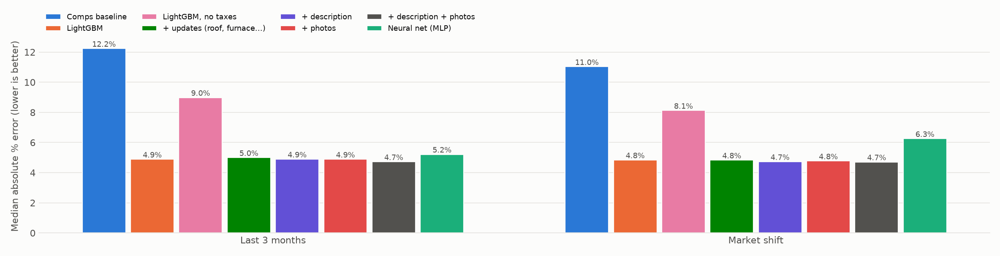

# Ottawa home value

Estimating what an Ottawa home would sell for, from MLS sold data. The project
compares a gradient-boosted tree model (LightGBM) with a neural network (an MLP
with categorical embeddings) and a classic comparable-sales baseline. Every
model is scored on the same time-based splits: train on the past, test on the
future.

It will power a "What's my home worth?" tool on [mertmetin.ca](https://mertmetin.ca),
so the models only use what a homeowner knows about their home. They never see
list price, days on market or the list-to-sale ratio.

> **Status:** research pipeline complete; the production service (estimate
> API, nightly recalibration, monthly retrain behind a promotion gate) runs on
> the server next to the data. Real-data results are not published yet.

## The problem

Automated valuations in Canada are mostly black boxes. This repo is an open,
reproducible look at how far public-style features get you in one city, and at
where each model family fails: by property type, neighbourhood and price band,
and when the market moves after training.

## Data (described, not shared)

The real data is Ottawa residential sales from the PropTx VOW feed (RESO Web
API), archived by my [listing engine](https://github.com/mertmetin/listing-alerts)
into a `sold_listings` table: one row per sale with the full listing record,
geocoded against municipal address points. PropTx data is licensed. It never
leaves the server, and no real record, trained model or real-data result file is
in this repository.

* About 22,500 Ottawa sales, November 2024 to November 2026. The VOW feed keeps
  roughly 24 months of sold history; the archive keeps every sale from now on,
  so the history grows.
* Sale date = the day the sale went firm (`PurchaseContractDate`), not the
  closing day, which can be months later.
* Fill rates for active Ottawa listings: square footage range 95%, beds 92%,
  baths 94%, taxes 92%, lot size 67%, approximate age 24%, bedrooms below grade 18%.
  PropTx sends no coordinates; 98% of sales geocode to a civic address and the
  rest to a postal-area centre.

`data/sample.csv` is **synthetic**: about 6,000 made-up sales in the same layout,
generated by `scripts/make_sample.py` from an invented pricing model, with
realistic missing fields and planted duplicates and typos. It lets anyone run
the whole pipeline. Its numbers say nothing about the real market.

## Method

**Cleaning** (`src/features.py: clean`) logs every removal: closed listings that
weren't completed sales, land / farms / mobile homes, duplicate keys, the same
address recorded as sold twice within 60 days (relists and double entries),
prices outside $75K–$8M, and $/sqft more than 4 robust SDs from its property type.

**Features**

| Group | Features |
|---|---|
| Property | type, size (PropTx size range → midpoint), beds above / below grade, baths, lot width × depth, approximate age, basement (kind, finished), garage, parking, style, heating, central air, annual taxes (and how old the tax figure is), condo fee |
| Location | latitude / longitude, neighbourhood (CityRegion), distance to downtown, distance to the nearest O-Train station that was open on the sale date |
| Market | sale month, time trend, 90-day median $/sqft in the neighbourhood and city-wide, the median price, $/sqft and distance of the 10 nearest sales of the same type in the previous 180 days |

Market features for a sale use **only sales that went firm before that day**, in
training and at prediction time. A test checks it: tripling every later price
leaves earlier rows' features unchanged.

**Models**

1. *Comps baseline*: median $/sqft of the 10 nearest recent sales of the same
   type × the home's size. What an agent's quick CMA does.
2. *LightGBM* on log(price), early-stopped on the newest 10% of training sales,
   plus 10th and 90th percentile models for a low–high range. The raw quantile
   models are overconfident on new sales, so the range is **calibrated** with
   conformalized quantile regression (Romano et al., 2019): on the newest 10%
   of training sales, which the quantile models never saw, measure how far
   prices fell outside the range and widen it just enough to contain 80% of
   them, separately per property group and predicted price band.
   A second LightGBM without the tax features measures how much the model
   leans on property tax (a proxy for the assessed value).
3. *MLP* (PyTorch): numeric features log-scaled, imputed with missing flags and
   standardised; an embedding per categorical; 512-256-128 with LayerNorm, SiLU
   and dropout; Huber loss on standardised log(price), AdamW, early stopping.
4. *TabPFN* (optional, `--models baseline,gbm,nn,tabpfn`) on the newest 10,000
   training sales.

**Splits**

* *Last 3 months*: train on everything before, test on the last 3 months.
* *Market shift*: train on the first 12 months only, test on everything after,
  to see how fast each model goes stale. (The original plan was 2021–22 → 2023+;
  the feed's 24-month window rules that out for now.)

**Metrics**: MAE, median absolute % error (MdAPE), share within 5% and 10%, and
median bias, overall and by property type, neighbourhood and price band; plus
how often the LightGBM range contains the sale price, before and after
calibration.

## Results

### Real Ottawa sales

Coming next.

### Synthetic sample (pipeline check only)

| Split | Model | MdAPE | Within 10% |
|---|---|---|---|
| Last 3 months | Comps baseline | 10.5% | 47.1% |
| | LightGBM | 4.4% | 86.4% |
| | Neural net | 4.4% | 85.1% |
| | LightGBM, no taxes | 7.2% | 63.2% |
| Market shift | Comps baseline | 10.8% | 46.9% |
| | LightGBM | 4.9% | 83.2% |
| | Neural net | 5.8% | 76.1% |
| | LightGBM, no taxes | 7.8% | 61.4% |



Full tables: [results/sample/results.md](results/sample/results.md).

## Production

The served model is LightGBM on the property, location and market features
plus the update questions a homeowner can answer (roof, windows, furnace, A/C,
kitchen, bathrooms, flooring, owned or rented water heater). In training those
update features come from what each listing description says; at serving time
they come from the owner's answers. Descriptions and photos help the research
model, but a homeowner has neither, so the served model doesn't use them.

```
 sold_listings (Postgres) ──nightly──> history snapshot ──> FastAPI /v1/estimate
            │                              │
            └──monthly──> candidate ──gate──> registry (versions, CURRENT)
                                           └──> drift.jsonl, promotions.jsonl
```

**Model registry** (`src/registry.py`): each version is a directory with the
three LightGBM models, a card (data window, code version, gate metrics, a
drift reference of the training data) and its nightly calibration. `CURRENT`
names the served version and is rewritten atomically, so promotion and
rollback (`python -m src.pipeline rollback`) are a one-line switch.

**Monthly retrain with a promotion gate** (`python -m src.pipeline retrain`):
the newest 45 days of sales are held out, a candidate is trained on the rest,
and the candidate and the served model are scored on held-out sales neither has
seen. The candidate is promoted only if its median error is within 0.25 points
of the served model's, its within-10% share within 2 points, its calibrated
range covers at least 70% of those sales, and its error is under a 10% sanity
limit. A promoted candidate is refit on every sale before it is saved. Every
decision, promoted or rejected, is logged.

**Nightly** (`python -m src.pipeline nightly`): new sales refresh the history
snapshot the API uses for market features; the served model is scored on the
sales it has never seen (median error, within 10%, bias, range coverage); input
drift is measured as the population stability index of key features for recent
sales and for the homes people asked about; and the 80% range is recalibrated
on the newest 2,000 sales its quantile models never saw. The research runs
showed coverage slipping from 79% to 72% over three months without it.

**API** (`src/api.py`): `POST /v1/estimate` takes the answers using the
website's question keys plus a location and returns the estimate, a low–high
range, the model version and what each answer moved the estimate by ("a
double garage adds about $38,000"). It reloads a new model or snapshot within
a minute without restarting. Requests are logged for drift checks without the
address, with the location rounded to about a kilometre. It returns no sold
prices or comparables, only counts.

```bash
uvicorn src.api:app --port 8000
curl -s localhost:8000/v1/estimate -H 'Content-Type: application/json' -d '{
  "property_type": "Townhome", "lat": 45.2766, "lng": -75.7438, "bedrooms": 3, "bathrooms": 3,
  "hv_sqft": "1500-2000", "hv_age": "16-30", "hv_basement": "Finished", "hv_garage": "1",
  "hv_upd_roof": "lt5", "hv_central_air": 1}'
```

On the server, `scripts/run_job.sh nightly|retrain` runs a job in Docker from
cron; `.env` (never in git) holds `DATABASE_URL` and `OHV_API_KEY`.

## Limitations

* The calibrated range holds 80% coverage in the first month after training
  and slips to the low 70s by month three as the market drifts. Production
  retrains monthly and recalibrates on the newest sales.
* Two years of history, all in one fairly flat market. No test yet of a sharp
  turn like 2022.
* Size is a range, not a number, and age is missing for three sales in four.
* The served model knows a home's condition only through the owner's update
  answers. Descriptions and listing photos help in research, but a homeowner
  has neither (photo upload is a possible next step).
* O-Train station coordinates in `data/otrain_stations.csv` are approximate
  (within a block); the Line 1 east and west extensions are not included yet.
* Sold prices are VOW data: the public tool will show estimates and ranges, not
  individual sold prices, to anyone not registered and signed in.

## Run it

```bash
uv venv --python 3.12 && uv pip install -e ".[dev]"
scripts/macos_openmp_fix.sh            # macOS only: one OpenMP runtime for torch + LightGBM
python scripts/make_sample.py          # regenerate data/sample.csv (optional)
python -m src.evaluate --data data/sample.csv --out results/sample
pytest
```

On the server, with `pip install -e ".[db]"` and `DATABASE_URL` set, `--data db`
reads the `sold_listings` archive instead.

| File | What it does |
|---|---|
| `src/data.py` | CSV / database loading into one layout |
| `src/features.py` | cleaning, features, the comps baseline |
| `src/geo.py` | distances to downtown and O-Train stations |
| `src/train_gbm.py` | LightGBM point + quantile models |
| `src/train_nn.py` | the MLP |
| `src/evaluate.py` | splits, metrics, breakdowns, charts |
| `src/text.py`, `src/photos.py` | description and photo features (research) |
| `src/homeowner.py` | a homeowner's answers -> one model row, and what each answer is worth |
| `src/registry.py` | model versions, promotion, rollback |
| `src/pipeline.py` | monthly retrain + gate, nightly drift + recalibration |
| `src/drift.py` | accuracy on unseen sales, PSI input drift |
| `src/api.py` | the FastAPI estimate service |
| `scripts/make_sample.py` | the synthetic dataset |
| `scripts/run_job.sh` | a pipeline job in Docker, for cron |

## License

MIT for the code. The sample data is synthetic and free to use.
